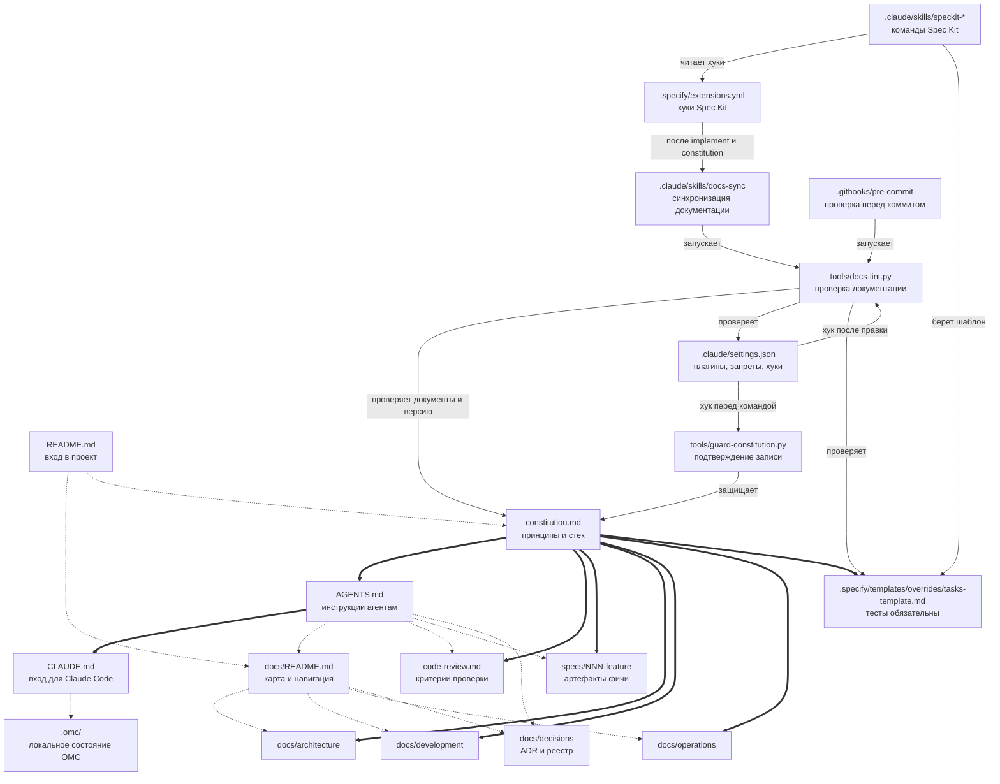

# Документация

> **Отвечает за:** навигацию по документации, карту источников истины и механику ведения документов.
> **Не содержит:** самих фактов. Они живут в файлах-владельцах из карты ниже.
> **Читать когда:** ищете, где описан факт, или добавляете и меняете документ.

**TL;DR:** у каждого факта один владелец, остальные ссылаются. Принципы ведения документации заданы принципом IX [конституции](../.specify/memory/constitution.md), здесь только механика.

## Разделы

| Раздел | О чем | Статус |
|---|---|---|
| [architecture](architecture/README.md) | устройство системы | частично, ждет MVP |
| [decisions](decisions/README.md) | ADR и реестр отложенных решений | реестр ведется, ADR появятся позже |
| [development](development/README.md) | проверка документации, автоматизация, затем окружение | частично, остальное не определено |
| [operations](operations/README.md) | конфигурация, деплой, эксплуатация | не определено |

## Карта источников истины

| Информация | Единственный источник |
|---|---|
| принципы, стек Backend, обязательные ограничения | [конституция](../.specify/memory/constitution.md) |
| последовательность Spec Kit, условия завершения задачи | [конституция](../.specify/memory/constitution.md#процесс-разработки-и-контроль-качества) |
| спецификация, план, задачи, исследования фичи | `specs/<NNN-feature>/`, каталог появится с первой фичей, статус задач только в `tasks.md`, исследования в `research.md` |
| инструкции агентам, порядок чтения, разграничение процесса | [AGENTS.md](../AGENTS.md) |
| подключение Claude Code, правила применения OMC | [CLAUDE.md](../CLAUDE.md) |
| критерии проверки кода | [code-review.md](../code-review.md) |
| контракты (OpenAPI, AsyncAPI, JSON Schema) и типы | пакет контрактов, структура не определена, правило в принципе III конституции |
| устройство системы | [architecture](architecture/README.md) |
| причины принятых решений | [decisions](decisions/README.md) |
| отложенные решения | [реестр](decisions/README.md#отложенные-решения) |
| окружение разработки, команды | [development](development/README.md) |
| конфигурация окружений, деплой, миграции, мониторинг | [operations](operations/README.md) |
| назначение проекта, вход | [README.md](../README.md) |
| правила ведения документации | этот файл |
| язык текстов и кода, переходный режим, разрешенные AI-зависимости | [конституция](../.specify/memory/constitution.md) |
| проверка документации, хуки, настройки Claude Code | [development](development/README.md#автоматизация-ai-среды), сами файлы: `.claude/settings.json`, `.specify/extensions.yml`, `.githooks/`, `tools/` |
| шаблоны Spec Kit, измененные проектом | `.specify/templates/overrides/`, причина в принципе VI конституции |
| скиллы проекта | `.claude/skills/`, кроме `speckit-*`, их ставит интеграция |
| рабочее состояние агентов | локальный каталог `.omc/`, игнорируется git, источником истины не является |

## Схема связей

- Жирная стрелка `A ==> B`: B опирается на A и не может ему противоречить.
- Пунктирная стрелка `A -.-> B`: A указывает на B как на источник истины и не копирует его содержимое.
- Подписанная стрелка `A -->|действие| B`: A выполняет действие над B или запускает его.
- Каждый файл харнеса (настройки, хуки, скрипты, скиллы проекта, переопределения шаблонов) должен быть показан на схеме, это проверяет [проверка документации](development/README.md#проверка-документации).
- Обратные навигационные ссылки из конституции на `AGENTS.md`, `code-review.md` и `docs/` зависимость не меняют.

## Механика ведения документов

- **Шапка.** Файл начинается с трех строк в цитате: отвечает за, не содержит, читать когда. Затем идет TL;DR одной-двумя фразами.
- **Отложенные темы.** Раздел с неопределенным содержимым содержит ссылку на [реестр](decisions/README.md#отложенные-решения) и формулировку "не определено". Пустые заглушки без пометки не создаются.
- **Ссылки.** Только относительные, на файл-владелец, с якорем на раздел, если нужен конкретный раздел. Вместо "см. выше" всегда явная ссылка.
- **Форматирование.** Простой Markdown, диаграммы в mermaid, без ASCII-графики. Язык задан в [разделе процесса конституции](../.specify/memory/constitution.md#процесс-разработки-и-контроль-качества).
- **Типографика.** Без буквы е с двумя точками, длинного тире, угловых кавычек, а также стрелки и многоточия в виде одного символа. Вместо тире дефис. Проверяется [проверкой документации](development/README.md#проверка-документации).
- **Новый факт.** Сначала определите владельца и добавьте строку в карту, потом пишите факт.

Механизмы автообновления и проверки описаны в [development](development/README.md#автоматизация-ai-среды).
