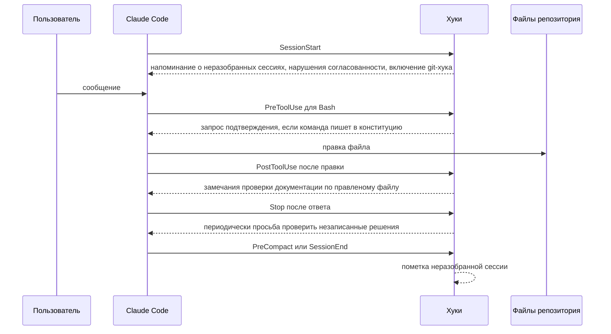
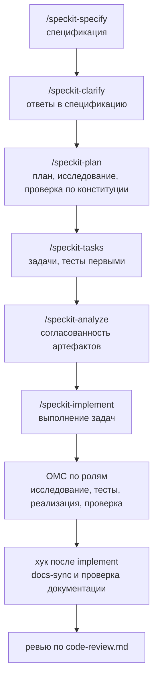

# Инфраструктура харнеса

> **Отвечает за:** состав харнеса, зависимости между компонентами, схему связей, потоки выполнения, места хранения состояния и точки отказа.
> **Не содержит:** команд и флагов ([reference.md](reference.md)), перечня возможностей ([capabilities.md](capabilities.md)) и гейтов ([quality-gates.md](quality-gates.md)).
> **Читать когда:** нужно понять, что от чего зависит, кто что вызывает и что сломается при отказе.
> **Проверено при версии конституции:** 3.0.0

**TL;DR:** харнес состоит из инструкций, Spec Kit, скиллов проекта, скриптов, хуков и тестов. Скрипты и скиллы замыкаются на `docs-lint`, хуки подключают их к сессии Claude Code и к git. Состояние лежит в репозитории, в `.omc/` и в папке проекта внутри `~/.claude`.

## Внешние зависимости

| Зависимость | Для чего нужна | Примечание |
|---|---|---|
| Claude Code | запуск агента, скиллов и хуков, режим без интерфейса для сценариев | версия при создании документа 2.1.286, формат расшифровок и данных хуков внутренний |
| Python 3 | все скрипты и тесты | только стандартная библиотека, при создании использовался 3.15, нижняя граница версии не определена, см. [реестр отложенных решений](../decisions/README.md#отложенные-решения) |
| git | git-хук, копии для тестов, проверка версии в индексе | |
| diff и patch | защита от дрейфа шаблонов Spec Kit | без них проверка переопределений не работает |
| bash | команды хуков и скрипты Spec Kit | |
| Spec Kit | цикл фичи, шаблоны, скрипты, хуки | версия в `.specify/init-options.json`, интеграция установила скиллы `speckit-*` |
| OMC | исполнение задач по ролям | плагин пользователя, не проекта, при создании документа 4.13.7 |
| папка `~/.claude` | настройки пользователя, расшифровки, память, состояние напоминаний | вне репозитория |
| скиллы и коннекторы платформы Claude | доступны как раньше | правилом об изоляции не затрагиваются, решение в [ADR 0002](../decisions/0002-ai-dependency-isolation.md) |

## Компоненты

В колонках указано, от чего компонент зависит, кто его вызывает и что вызывает сам.

### Инструкции и правила

| Компонент | Зависит от | Кто вызывает или читает | Что вызывает |
|---|---|---|---|
| `.specify/memory/constitution.md` | ничего | все агенты, `docs-lint`, `speckit-constitution` пишет | ничего |
| `AGENTS.md` | конституция, карта источников | агенты при старте, `CLAUDE.md` через импорт | ничего |
| `CLAUDE.md` | `AGENTS.md` | Claude Code при старте, `docs-lint` проверяет импорт | ничего |
| `code-review.md` | принципы конституции | `verifier`, `code-reviewer`, люди при ревью | ничего |

### Документация

| Компонент | Зависит от | Кто вызывает или читает | Что вызывает |
|---|---|---|---|
| `docs/README.md` | конституция | `docs-lint` проверяет карту, агенты ищут владельцев | ничего |
| `docs/decisions/README.md` | конституция | `docs-lint` требует ссылку на реестр, агенты проверяют отложенные темы | ничего |
| `docs/harness/` | файлы харнеса | `docs-lint` проверяет схему и описание, каталог кирпичиков `bricks.md` проверяется отдельно | ничего |

### Spec Kit

| Компонент | Зависит от | Кто вызывает или читает | Что вызывает |
|---|---|---|---|
| скиллы `speckit-*` | шаблоны, скрипты, `.specify/extensions.yml` | пользователь, агенты | скрипты Spec Kit, хуки из `.specify/extensions.yml` |
| `.specify/scripts/bash/` | шаблоны, git | скиллы `speckit-*` | git |
| `.specify/templates/` и `.specify/templates/overrides/` | ничего | `resolve-template.sh` по стеку: проект, пресеты, расширения, ядро | ничего |
| `.specify/extensions.yml` | скиллы проекта | скиллы `speckit-*`, `docs-lint` проверяет соответствие команд скиллам | `hot-zones`, `docs-sync` и `audit` через скиллы Spec Kit |
| `.specify/workflows/feature-chain/workflow.yml` | скиллы `speckit-*`, `docs-sync`, `tools/check-feature.py`, `tools/docs-lint.py`, каталог кирпичиков | `specify workflow run feature-chain`, `docs-lint` сверяет с каталогом | скиллы командами шагов, проверки шагами shell |

### Скиллы проекта

| Компонент | Зависит от | Кто вызывает | Что вызывает |
|---|---|---|---|
| `.claude/skills/docs-sync` | карта, `docs-lint` | хук Spec Kit, пользователь | `tools/docs-lint.py` |
| `.claude/skills/audit` | конституция, все файлы харнеса | хук Spec Kit предлагает, пользователь | отдельный агент Explore, `tools/docs-lint.py` с метками |
| `.claude/skills/capture` | таблица маршрутизации в `AGENTS.md`, карта | пользователь, напоминания | `tools/docs-lint.py`, `tools/capture-reminder.py` с очисткой |
| `.claude/skills/harvest` | расшифровки, память Claude | пользователь, напоминание при старте | `tools/harvest.py`, `capture`, `tools/capture-reminder.py` с очисткой |
| `.claude/skills/cold-start` | `.claude/skills/cold-start/questions.md` | пользователь | отдельный агент Explore |
| `.claude/skills/epic-new` | трекер работы, реестр отложенных решений, `docs/harness/bricks.md` | пользователь | `tools/work.py`, инструмент AskUserQuestion |
| `.claude/skills/work-start` | трекер работы, скилл `speckit-specify` | пользователь | `tools/work.py`, `/speckit-specify` |
| `.claude/skills/work` | трекер работы | пользователь | `tools/work.py` |
| `.claude/skills/hot-zones` | реестр зон, спецификация и план фичи | хук Spec Kit перед планом, пользователь | инструмент AskUserQuestion, `tools/docs-lint.py` |
| `.claude/skills/harness-eval` | сценарии, раннер | пользователь | `tools/harness-eval.py`, `tools/docs-lint.py`, тесты |

### Скрипты

| Компонент | Зависит от | Кто вызывает | Что вызывает |
|---|---|---|---|
| `tools/docs-lint.py` | все документы, `.claude/settings.json`, `.specify/extensions.yml`, шаблоны и патчи, `tests/harness/coverage.json`, git | git-хук, хуки Claude Code, скиллы `docs-sync`, `capture`, `audit`, `harness-eval`, тесты, пользователь | git, diff, patch |
| `tools/guard-constitution.py` | данные хука | хук PreToolUse | ничего |
| `tools/capture-reminder.py` | данные хука, состояние в папке проекта | хуки Stop, SessionEnd, PreCompact, SessionStart, скиллы очищают | ничего |
| `tools/work.py` | файлы в `work/`, каталоги в `specs/`, `tools/docs-lint.py` для уровней контроля | скиллы `epic-new`, `work-start`, `work`, `tools/docs-lint.py` и git-хук проверяют, пользователь | ничего |
| `tools/check-feature.py` | `.specify/feature.json`, артефакты фичи в `specs/`, версия конституции из `tools/docs-lint.py` | шаги shell цепочки `feature-chain`, пользователь | ничего |
| `tools/harvest.py` | расшифровки и память в папке проекта, документы репозитория | скилл `harvest` | ничего |
| `tools/harness-eval.py` | `claude`, сценарии, вопросы `cold-start` | скилл `harness-eval`, пользователь | `claude -p`, git |

### Настройки и хуки

| Компонент | Зависит от | Кто вызывает или читает | Что вызывает |
|---|---|---|---|
| `.claude/settings.json` | скрипты в `tools/` | Claude Code, `docs-lint` и тесты проверяют | `tools/docs-lint.py`, `tools/guard-constitution.py`, `tools/capture-reminder.py` |
| `.githooks/pre-commit` | `tools/docs-lint.py` | git при коммите, включается настройкой `core.hooksPath` | `tools/docs-lint.py` с режимом индекса |

### Тесты

| Компонент | Зависит от | Кто вызывает | Что вызывает |
|---|---|---|---|
| `tests/harness/` | все скрипты, эталонные данные хуков, заглушка `claude` | пользователь, скилл `harness-eval` | скрипты харнеса во временных копиях |
| `evals/cases/` | ничего | `tools/harness-eval.py` | ничего |

## Схема связей

```mermaid
flowchart TD
    C["constitution.md<br/>принципы и стек"]
    A["AGENTS.md<br/>инструкции агентам"]
    CL["CLAUDE.md<br/>вход для Claude Code"]
    CR["code-review.md<br/>критерии проверки"]
    S["specs/NNN-feature<br/>артефакты фичи"]
    R["README.md<br/>вход в проект"]
    D["docs/README.md<br/>карта и навигация"]
    AR["docs/architecture"]
    DV["docs/development"]
    OP["docs/operations"]
    DC["docs/decisions<br/>ADR и реестр"]
    SPK[".claude/skills/speckit-*<br/>команды Spec Kit"]
    OV[".specify/templates/overrides/tasks-template.md<br/>.specify/templates/overrides/tasks-template.patch<br/>.specify/templates/overrides/plan-template.md<br/>.specify/templates/overrides/plan-template.patch<br/>.specify/templates/overrides/spec-template.md<br/>.specify/templates/overrides/spec-template.patch<br/>тесты обязательны, версия конституции, зоны и образец в плане, уровень контроля в спецификации"]
    AUD[".claude/skills/audit<br/>смысловой аудит"]
    EXT[".specify/extensions.yml<br/>хуки Spec Kit"]
    SYNC[".claude/skills/docs-sync<br/>синхронизация документации"]
    LINT["tools/docs-lint.py<br/>проверка документации"]
    GUARD["tools/guard-constitution.py<br/>подтверждение записи"]
    SET[".claude/settings.json<br/>плагины, запреты, хуки"]
    GIT[".githooks/pre-commit<br/>проверка перед коммитом"]
    OMC[".omc/<br/>локальное состояние OMC"]
    CAP[".claude/skills/capture<br/>запись решения владельцу"]
    HAR[".claude/skills/harvest<br/>поиск повторяющегося контекста"]
    COLD[".claude/skills/cold-start<br/>проверка с чистого листа"]
    HARV["tools/harvest.py<br/>анализ сессий"]
    REM["tools/capture-reminder.py<br/>напоминания о записи"]
    TRN["расшифровки сессий и память Claude<br/>вне репозитория"]
    TST["tests/harness<br/>тесты харнеса"]
    EV["evals/cases<br/>сценарии поведения"]
    HE["tools/harness-eval.py<br/>запуск сценариев"]
    HSK[".claude/skills/harness-eval<br/>ручной прогон сценариев"]
    CHK["tools/check-feature.py<br/>проверка артефактов фичи"]
    HZ[".claude/skills/hot-zones<br/>опрос о горячих зонах"]
    WK["tools/work.py<br/>трекер работы"]
    WD["work/<br/>эпики и элементы работы"]
    EPN[".claude/skills/epic-new<br/>создание эпика"]
    WST[".claude/skills/work-start<br/>передача фичи в Spec Kit"]
    WSK[".claude/skills/work<br/>доска, очередь, статус"]
    HZD["docs/architecture/hot-zones.md<br/>реестр зон"]
    WF[".specify/workflows/feature-chain/workflow.yml<br/>цепочка фичи без диалога"]
    BRK["docs/harness/bricks.md<br/>кирпичики и уровни контроля"]

    C ==> A ==> CL
    C ==> CR
    C ==> S
    C ==> AR
    C ==> DV
    C ==> OP
    C ==> OV

    R -.-> D
    R -.-> C
    D -.-> AR
    D -.-> DV
    D -.-> OP
    D -.-> DC
    A -.-> D
    A -.-> CR
    A -.-> S
    A -.-> DC
    C -.-> OMC

    SPK -->|читает хуки| EXT
    SPK -->|берет шаблон| OV
    EXT -->|после implement и constitution| SYNC
    SYNC -->|запускает| LINT
    SET -->|хук после правки| LINT
    SET -->|хук перед командой| GUARD
    GIT -->|запускает| LINT
    GUARD -->|защищает| C
    LINT -->|проверяет документы и версию| C
    LINT -->|проверяет| SET
    LINT -->|ловит дрейф шаблонов| OV
    SET -->|при старте сессии| LINT
    EXT -->|после constitution предлагает| AUD
    AUD -->|сверяет файлы с| C
    SET -->|хуки Stop, SessionEnd, PreCompact, SessionStart| REM
    REM -->|напоминает запустить| CAP
    REM -->|напоминает запустить| HAR
    HAR -->|запускает| HARV
    HARV -->|читает| TRN
    HAR -->|передает кандидатов| CAP
    CAP -->|после записи запускает| LINT
    COLD -->|проверяет, что факты находятся| A
    HSK -->|запускает| HE
    HE -->|гоняет| EV
    HE -->|в чистой копии проверяет харнес| A
    TST -->|проверяет| LINT
    TST -->|проверяет| REM
    LINT -->|требует тест для каждого файла харнеса| TST
    EPN -->|создает элементы| WK
    WST -->|привязывает фичу| WK
    WSK -->|читает и меняет статус| WK
    WK -->|читает и пишет| WD
    WK -->|выводит статус из| S
    WST -->|запускает| SPK
    LINT -->|запускает проверку трекера| WK
    TST -->|проверяет| WK
    EXT -->|перед планом| HZ
    HZ -->|записывает ответ| HZD
    HZ -->|правила ask по путям зон| SET
    LINT -->|проверяет реестр зон| HZD
    WF -->|команды шагов| SPK
    WF -->|после каждого шага проверка| CHK
    WF -->|шаги берутся из| BRK
    CHK -->|читает| S
    LINT -->|проверяет каталог| BRK
    LINT -->|сверяет цепочку с каталогом| WF
    TST -->|проверяет| CHK
```

- Жирная стрелка `A ==> B`: B опирается на A и не может ему противоречить.
- Пунктирная стрелка `A -.-> B`: A указывает на B как на источник истины и не копирует его содержимое.
- Подписанная стрелка `A -->|действие| B`: A выполняет действие над B или запускает его.
- Каждый файл харнеса (настройки, хуки, скрипты, скиллы проекта, переопределения шаблонов) должен быть показан на схеме, это проверяет [проверка документации](reference.md#проверка-документации).
- Обратные навигационные ссылки из конституции на `AGENTS.md`, `code-review.md` и `docs/` зависимость не меняют.

## Потоки выполнения

### Сессия Claude Code

### Жизненный цикл фичи

### Коммит

1. Git запускает `.githooks/pre-commit`, если включен `core.hooksPath`.
2. Хук запускает `tools/docs-lint.py` в режиме индекса.
3. Проверка читает рабочее дерево, а для конституции индекс: версия должна вырасти, временного отчета быть не должно.
4. Любое нарушение останавливает коммит. Обойти хук можно командой с `--no-verify`, агентам она запрещена в настройках, человеку нет.

### Поправка конституции

1. Агент запускает `/speckit-constitution`, правка файла требует подтверждения пользователя по правилу в настройках, а команды Bash с записью в файл проверяет хук PreToolUse.
2. Скилл повышает версию и добавляет временный отчет.
3. После обновления Spec Kit запускает `docs-sync` автоматически и предлагает `audit`.
4. Файлы с устаревшей меткой сверяются с новой редакцией и получают метку командой `--stamp`.
5. Перед коммитом отчет удаляется, иначе git-хук отклонит коммит.

### Правка харнеса

1. Правка файла вызывает проверку документации по этому файлу.
2. Перед коммитом запускаются тесты харнеса, это ручной шаг.
3. Если состав харнеса изменился, обновляется манифест, проверка покрытия требует запись о тестах для нового файла.
4. Сценарии поведения запускаются после крупных правок инструкций, правило перепрогона при смене модели или версии Claude Code задано конституцией.
5. Коммит проходит git-хук.

### Знания из чата

1. Хук Stop периодически просит агента найти незаписанные решения, частота описана в [справочнике](reference.md#скрипты).
2. Агент предлагает `/capture`, скилл определяет владельца по таблице маршрутизации и записывает правку после подтверждения.
3. Хуки PreCompact и SessionEnd помечают сессию, хук SessionStart напоминает о пометке в следующей сессии.
4. `/harvest` ищет повторяющийся контекст в расшифровках и в памяти Claude и передает кандидатов в `capture`.

## Где живет состояние

| Место | Что лежит | Кто пишет | Очистка | В git |
|---|---|---|---|---|
| репозиторий | документы, скрипты, настройки, тесты, сценарии | люди и агенты | правки и коммиты | да |
| `.omc/` | состояние OMC | OMC | вручную, потеря ничего не ломает | нет |
| папка проекта в `~/.claude/projects` | расшифровки сессий, память Claude | Claude Code | Claude Code, насколько известно, удаляет старые расшифровки сам, срок описан в [справочнике](reference.md#автоматизация-ai-среды) | нет |
| подпапка `capture` в папке проекта | пометки неразобранных сессий и счетчики ходов | `tools/capture-reminder.py` | команда очистки, счетчики старше тридцати дней удаляются сами | нет |
| временные копии репозитория | рабочие копии тестов и сценариев | тесты и `tools/harness-eval.py` | удаляются после прогона | нет |
| папка results в каталоге `evals` | итог последнего прогона сценариев | `tools/harness-eval.py` | вручную | нет |
| папка runs в `.specify/workflows` | состояние запусков воркфлоу Spec Kit | движок Spec Kit | вручную, потеря означает невозможность продолжить запуск | нет |
| `~/.claude/settings.json` | пользовательские плагины и настройки | пользователь | вручную | нет, проектные настройки их перекрывают |

## Точки отказа

| Что может сломаться | Последствие | Как заметить | Что делать |
|---|---|---|---|
| настройки проекта не перечитаны | хуки и запреты не работают | сообщение о нарушениях при старте не приходит | перезапустить Claude Code |
| расширение `platform` не существует в Spec Kit | хук `docs-sync` может не сработать, никто не узнает | сценарий `docs-sync` и пилотная фича | проверить на первой фиче, тема в реестре |
| внутренний формат расшифровок изменился | `harvest` не находит реплики | предупреждение скрипта | обновить скрипт |
| старые расшифровки удалены, срок не проверен | знания из чата потеряны безвозвратно | напоминание о неразобранной сессии | разобирать напоминание вовремя |
| git-хук не включен в клоне | нарушения попадают в коммит | старт сессии Claude Code включает его, чужие клоны нет | выполнить настройку клона, CI отложен |
| коммит с `--no-verify` | проверка пропущена | CI нет | дисциплина, CI в реестре |
| шаг цепочки остановился на правах или вопросе агента | движок считает его успехом, проверка шага не пройдена и запуск падает с кодом возврата проверки | сообщение о провале шага check-... без причины, причину показывает вывод проверки при запуске вручную | запустить проверку вручную, продолжить командой `specify workflow resume` |
| слабая модель | нарушает принципы I и IX, теряет решения | сценарии поведения | использовать рабочую модель |
| обновление OMC или Claude Code | поведение и формат данных меняются | тесты и сценарии | перепрогнать после обновления |
| нет `diff` или `patch` | проверка шаблонов падает | сообщение проверки документации | установить утилиты |
| пользовательские MCP-серверы вне плагинов | остаются включенными | нет проверки | тема в реестре |
